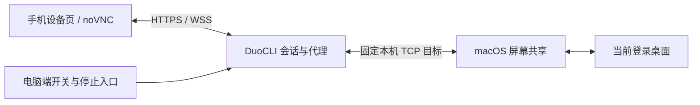

# 手机网页操控 Mac 桌面 Spec

日期：2026-09-15  
版本：0.1  
状态：待技术验证；产品边界与执行顺序已定义，未实现、未通过真机验收。  
适用：运行 DuoCLI 的 Mac，以及连接该实例的手机网页 / PWA。

## 1. 目标与推进结论

用户在手机 DuoCLI 的「设备」页选择「这台 Mac」，即可看到当前 Mac 桌面，操作浏览器、Finder、DuoCLI 等窗口，完成点按、拖拽、滚动、快捷键和中文输入。手机无需安装远控 App。

先验证 **macOS 系统屏幕共享 + 内嵌 noVNC + DuoCLI WebSocket 代理**。验证通过后再整合设备页；不预先承诺该路线的流畅度。若认证、当前桌面连接、输入或性能无法达标，再进入 Electron 采屏 + WebRTC 的备选验证。

本次文档交付不包含开启系统共享、安装依赖、改业务代码或部署。后续实施按第 10 节推进。

## 2. 问题、用户与证据

核心用户是已在 Mac 运行 DuoCLI、通过手机远程工作的电脑主人。终端能处理 CLI 工作，但遇到浏览器按钮、系统对话框、Finder 或桌面窗口时，用户仍需回到电脑。

用户原始目标：「直接把家电脑的桌面 stream 过来……让我可以操作我现在的苹果电脑」。成功结果是完成实际桌面任务，而不只是网页显示一张截图。

目前只有该用户需求与代码调研证据，没有普遍需求比例、商业收益或性能基线；不据此推导留存、收入或市场规模。

### 2.1 当前工程事实

| 证据 | 已确认事实 | 对新功能的约束 |
| --- | --- | --- |
| `mobile/client/index.html`、`app.js` | 已有「手机设备」入口及设备页 | 在既有设备页增加 Mac 类型 |
| `src/main/remote-server.ts` | Android 提供 H.264/WebSocket、JPEG/WebSocket；capabilities 的 `webRtc` 为 false | WebRTC 不能作为已交付能力引用 |
| `native/android-media/main.go` | 存在 Pion helper 原型 | 不代表公网或 Safari 已通过 |
| `mobile/client/android-pointer-helpers.js` | 已处理画面容纳、黑边和坐标换算 | 可参考算法，不能把 Android 控制协议直接套到 Mac |
| `src/main/android-mirror.ts` | 已有控制权及 epoch 逻辑 | 可参考生命周期，VNC 必须按自身连接语义实现 |
| `src/main/cloudflared-manager.ts` | 项目已有公网入口管理 | 复用网页/API/WSS 入口，重新实测带宽与恢复 |

同会话前序只读检查得到本机 macOS 26.2；正式验证时重新记录系统版本、芯片、DuoCLI 构建、noVNC 固定版本、手机和浏览器版本。代码存在与官方兼容性说明均不能代替设备证据。

## 3. 范围与默认决策

### 3.1 首版必须包含

- 一台主机：当前连接的 DuoCLI 所在 Mac，使用该 Mac 的现有桌面会话。
- 一个活动远控会话；本地键鼠仍能工作，电脑主人可随时停止网页远控。
- 手机横竖屏查看、画面适配、放大与平移。
- 默认触控板模式；可切换直接点按模式。
- 左键、双击、右键、明确的拖拽模式、双指滚动。
- 手机输入框、中文发送、基础快捷键。
- 局域网与既有公网域名；iPhone Safari 为主要验收端，Android Chrome 为第二验收端。
- 首次启用引导、会话状态、断开、重连与服务端撤销。

### 3.2 首版边界

- 目标为 Mac 已开机、已登录、DuoCLI 正在运行、系统共享可用的场景。
- 首个发布目标为单显示器配置。多屏若返回拼接桌面且不能可靠限制显示范围，显示不支持的原因，不裁掉部分画面后继续盲目输入。
- 锁屏时终止当前输入会话；恢复后重新连接。远程解锁、开机前 FileVault 解锁、合盖唤醒、自动登录和重启后无人值守不属于承诺能力。
- 音频、录像、文件传输、远程系统电源操作、多用户旁观、Windows/Linux 主机和其他局域网电脑不在首版范围。
- 默认不自动同步剪贴板；只有用户主动发送文字时才传送。
- JPEG 不作为已确定的首版主路线；WebRTC 也不是默认同时开发的第二套实现。

## 4. 用户流程与验收需求

### D01：发现与启用

将既有入口文案「手机设备」调整为「设备」，列出 Android 设备与「这台 Mac」。Mac 卡片提供「未启用」「待设置」「可连接」「正在连接」「使用中」「连接失败」状态；卡片存在不代表桌面可用。

桌面设置增加「允许通过 DuoCLI 操作这台 Mac」，默认关闭。电脑主人显式开启后保留该设置，后续远程连接不要求电脑前逐次确认。引导到系统屏幕共享设置，并显示实际探测结果；不自动修改共享、系统权限、防火墙或登录设置。

验收：未开启时服务端拒绝桌面会话；启用但系统服务未就绪时显示可执行说明；返回设备页不影响原有终端或 Android。

### D02：进入当前桌面

点击「连接」后依次展示连接、Mac 认证、等待画面；收到并呈现画面后才显示「已连接」。Mac 认证凭据与 DuoCLI 登录凭据分开处理。首版不记住 Mac 密码，输入仅存当前页面内存，认证完成或失败后清除凭据引用，禁止进入日志、URL、localStorage 或离线缓存。

优先验证 Apple VNC 认证协商，使用获准共享的 Mac 本地用户账户，不是 Apple ID。连接必须显示电脑当前登录用户正在使用的桌面，不能悄悄连接到另一个登录会话。认证方式、系统提示和并发登录行为均为 P0 验证项；不自动降级到无认证。

验收：手机与电脑看到同一测试窗口；手机点击后电脑实际响应；认证失败与首帧失败分别显示，不以 TCP/WebSocket 已连接判定可用。

### D03：手机手势

| 场景 | 触控板模式（默认） | 直接点按模式 |
| --- | --- | --- |
| 单指移动 | 移动远端鼠标，不按下鼠标 | 按下后移动为拖动；越过手势阈值再判定 |
| 轻点 / 双击 | 在当前鼠标位置单击 / 双击 | 在所点画面位置单击 / 双击 |
| 右键 | 工具栏右键作用于当前鼠标位置 | 工具栏选右键后下一次点按执行一次 |
| 拖拽 | 开启「拖拽」后移动；再次点按结束 | 单指按下移动，抬起结束 |
| 双指移动 | 滚动远端内容 | 滚动远端内容 |
| 画面缩放、平移 | 通过「查看」模式操作本地视口 | 同左 |

「查看」模式暂停全部远端输入：双指捏合缩放、单指平移，并提供「适应屏幕」「返回操作」。这样本地放大与远端滚动不会争用同一手势。切换模式前释放所有按键和鼠标按钮。

触控板鼠标位置从连接时可确定的位置初始化；无可用服务端光标位置时先明确定位至画面中心。相对移动换算为 VNC 绝对坐标。旋转、分辨率变化、键盘弹出、模式切换期间取消手势，布局与坐标更新完毕后恢复。画面黑边不发送输入。

验收：菜单栏、窗口边角、画面中心测试目标均可准确命中；拖动窗口后没有鼠标卡住；横竖屏及 Retina 缩放下无系统性偏移。

### D04：文字与快捷键

- 工具栏提供「键盘」、Esc、Tab、Enter、方向键及 ⌘ 组合键；先覆盖 ⌘C、⌘V、⌘A、⌘Z、⌘Tab。
- 手机输入框在中文输入法组合完成后，由用户点「发送」提交文本；发送文字不自动附加回车。
- 优先验证 VNC Unicode 输入或剪贴板扩展。若必须使用剪贴板粘贴，界面明确告知会替换 Mac 剪贴板；不读取原剪贴板来暗中恢复。
- 中英文、换行、emoji 为必测样本。不能因 noVNC 声明支持 Unicode 就认定 Mac 服务端也兼容。
- 密码框使用可验证的按键输入；若不支持，显示具体限制，不把失败包装成成功。
- 网络不确定时显示「发送结果未确认」，保留输入草稿，禁止自动重放文字、回车或快捷键。VNC 写入成功不是应用执行确认。

验收：在专用 TextEdit 文档发送「你好 Mac，测试 ABC 123 👋」及多行文字，内容正确且不重复；切换应用和撤销正常；断线重连不重复输入。

### D05：占用与停止

首版只允许一个远控会话。第二个网页显示「另一连接正在使用」，不自动抢占。旧会话超时释放后可连接；电脑端「断开并暂停远控」立即关闭当前桥接连接、废止票据并关闭 DuoCLI 远控开关。再次启用需在电脑端操作。

电脑端必须持续显示「手机正在操作这台 Mac」及停止入口。应用退出也清理连接。停止 DuoCLI 远控仅管理本功能，不声称关闭系统屏幕共享或其他远控软件。

验收：直接调用接口、复制票据、多开标签页均无法绕过单会话限制；停止后旧网页与旧票据不能重新取得控制。

## 5. 技术方案与职责

### 5.1 复用与新增

复用现有登录、公网入口和设备页外壳。新增 Mac 会话管理与 WebSocket→TCP 字节流桥接，不引入单独的 Guacamole 服务。系统屏幕共享承担采集和输入；该路线不要求 DuoCLI 自行申请采屏或输入注入权限。

VNC 是含画面、输入和认证的有状态双向协议流，不包装成 Android DVM2 帧，也不按 WebSocket 消息边界解释完整 RFB 消息。首版使用单人完整远控，**不提供仅由前端 `viewOnly` 属性保障的安全只读模式**。若将来增加只读或多人控制，必须设计服务端协议过滤或受控协议终结层。

noVNC 版本在 P0 固定，记录来源、许可证与依赖清单，随应用打包，不从 CDN 动态加载。优先使用公开 API；触控板所需指针接口若未公开，在独立适配模块维护最小补丁并固定版本，禁止在 app.js 中散落调用内部字段。该改造成本计入 P0 决策。

### 5.2 拟新增/修改模块（规划路径）

| 路径 | 职责 |
| --- | --- |
| `src/main/mac-desktop-session.ts` | 主机能力、开关、单会话、票据、状态和清理 |
| `src/main/mac-desktop-routes.ts` | API、鉴权、Origin 校验及 WS/TCP 代理 |
| `src/main/remote-server.ts` | 注册 Mac 路由与 upgrade 分发 |
| `mobile/client/mac-desktop-client.js` | noVNC 封装、状态、视口、手势和文字发送 |
| `mobile/client/app.js`、`index.html`、现有样式文件 | 设备类型与工具栏 |
| `src/main/index.ts`、`src/preload/index.ts`、桌面 renderer | 启用设置、状态和停止入口 |
| `package.json`、打包/资源脚本、service worker | 固定依赖、离线静态资源版本与许可证 |
| `tests/mac-desktop-*.test.mjs`、`tests/e2e/mac-desktop.e2e.mjs` | 会话/代理行为及页面集成 |

执行前检查这些路径的当前变更。本次写 Spec 时，cloudflared-manager、main/index、preload/index、renderer/index.html 已有未提交修改；不可恢复或覆盖，实施需围绕现状做最小补丁。

### 5.3 会话接口草案

- `GET /api/mac-desktop/capabilities`：返回 enabled、serviceReachable、busy、支持情况和 reasonCode；不返回凭据。
- `POST /api/mac-desktop/sessions`：既有登录认证通过且本机已启用后，原子分配 sessionId 与 30 秒单次票据；响应禁止缓存。
- `/mac-desktop-ws`：先完成应用层票据验证，再连接固定本机屏幕共享端点；5 秒未认证关闭。浏览器适配器需验证可在 noVNC 握手前完成此步骤。
- `POST /api/mac-desktop/sessions/:id/disconnect`：只有会话持有者或电脑端可关闭；重复调用无副作用。
- 电脑端 enable/disable 经本地 IPC 操作，网页不能开启已关闭的远控功能。

票据使用密码学随机值，绑定 sessionId、登录主体和开关代次；消费一次即失效。远控关闭、退出登录、认证失效或进程重启全部撤销。WS 校验允许的局域网/公网 Origin，不能简单信任任意 Origin 或 Host。现有登录方式的跨站请求保护一并纳入接口验证。

目标固定本机解析后的 loopback 地址和服务端配置端口，网页不得提交任意 host/port。不开放新的公网 VNC 端口。代理走 loopback 并不意味着系统 VNC 服务只监听 loopback；设置引导需如实说明系统共享的网络可达范围。

### 5.4 流控与故障处理

- WS 与 TCP 双向尊重背压；初始待验证预算为每会话 8 MiB 待发送数据，或持续阻塞 3 秒后关闭并重建。不能随意丢弃 RFB 字节继续解码。
- 页面切后台主动断开；恢复前台建立新会话、重新认证和等待新画面，输入不重放。
- 服务端每 5 秒 ping，15 秒未获得响应回收连接；占用必须有服务端超时，不能依赖页面 unload。
- 健康连接下静止桌面可能没有新帧，不能仅凭无画面更新判定失联。遇连接错误、挂起或已知主机锁屏事件，遮罩旧画面并停止输入。
- 释放顺序：停止接受输入→客户端尽力发送已按下按钮/按键的释放→关闭 WS/TCP→撤销会话。网络硬断时客户端释放不可达，因此必须实测系统 VNC 断开清理行为；不能假定原始代理能可靠补发输入。
- 重连等待采用 1、2、4 秒，最多三次；Mac 密码失败不自动重试。需重新输入凭据时停在认证界面。

## 6. 状态与错误文案

| 状态/原因 | 手机展示 | 输入 |
| --- | --- | --- |
| disabled | 请在电脑端启用远程桌面 | 禁止 |
| setup-required | 请在 Mac 系统设置中完成屏幕共享设置 | 禁止 |
| busy | 另一连接正在使用 | 禁止 |
| connecting / authenticating | 正在连接 / 请输入 Mac 认证信息 | 禁止 |
| awaiting-frame | 已连接，正在等待画面 | 禁止 |
| active | 已连接 | 允许 |
| suspended / disconnected | 连接已暂停 / 已断开 | 禁止，遮罩旧画面 |
| auth-failed | Mac 认证失败，请检查账户和共享权限 | 禁止 |
| service-unreachable | 无法连接 Mac 屏幕共享服务 | 禁止 |
| unsupported-display | 当前显示器配置暂不支持 | 禁止 |
| protocol-error / congested | 画面连接异常 / 网络拥堵，请重新连接 | 禁止 |

无法可靠识别睡眠或锁屏时显示连接不可用，不猜测具体原因。诊断保留 sessionId、阶段、错误码、耗时、字节计数和版本；禁止记录画面、输入内容、剪贴板和密码。

## 7. 成功标准与证据

主指标：用户无需走回 Mac，连续完成「切到浏览器→点击页面→滚动→输入中文→拖动窗口→切回 DuoCLI」任务。初始无基线；以下为拟定验收目标，不是已测性能或对外承诺。

| 项目 | 验收门槛 | 方法 |
| --- | --- | --- |
| 完整任务 | 主要 iPhone 每种网络连续 5 次成功；Android Chrome 每种网络至少 1 次成功 | 专用测试页面/文档，记录步骤与结果 |
| 首帧 | 已完成认证后 LAN P95 ≤3 秒，蜂窝网络 P95 ≤8 秒 | 每种网络 20 次连接，记录画面呈现时点 |
| 点击到可见结果 | LAN P95 ≤250ms，蜂窝 P95 ≤600ms | 每种网络 30 次；同一录像记录手机触碰与手机画面响应 |
| 输入准确性 | 规定文字样本与快捷键全部通过，无重复或粘键 | Mac 实际应用检查 |
| 恢复 | 后台恢复/网络切换各 5 次成功；凭据提交后 10 秒内恢复 | 不把等待用户输入密码计入网络恢复耗时 |
| 稳定性 | 30 分钟混合操作，无崩溃、失控或持续增长的队列 | 主机资源与桥接流控日志 |
| 停止 | 本地停止后 1 秒内关闭代理；旧票据全部拒绝 | 客户端与服务端共同核验 |

测试记录必须包含 Mac/手机/浏览器/noVNC/DuoCLI 版本、分辨率、网络类型、RTT、样本数与失败原因。记录 CPU、内存和流量作为基线；不把 WS 写入时间当端到端延迟，不以平均值替代 P95。

## 8. 测试矩阵与发布门槛

- 自动化：未启用/未认证拒绝、票据过期/重放、并发分配、Origin 拒绝、任意目标拒绝、会话回收、流控断开、异常 RFB 流、无输入重放。
- 浏览器集成：设备切换、工具栏、视口变化、触控板/直接点按/查看模式互斥、中文 composition、错误状态、旧画面遮罩。
- 真机：Mac 当前桌面、Retina、横竖屏、软键盘、中文、右键/拖拽/滚动、网络硬断期间按住 ⌘ 或鼠标、应用退后台、锁屏/睡眠后恢复。
- 打包：安装包内资源完整、无外部 CDN 依赖、认证页及会话 API 不被 service worker 缓存。
- 回归：现有 Android 控制、终端连接、快捷命令、文件链接与公网入口正常。按改动执行 `npm run build:ts`、`npm run test:unit` 及相关 E2E；最终发布执行仓库要求的完整检查。

本地模拟、Puppeteer 手机尺寸、单元测试或安装包生成成功均不能代替真机远控验收。没有实际蜂窝网络证据不得标记「公网通过」。

## 9. 风险与路线切换规则

| 风险 | P0 要回答的问题 | 决策 |
| --- | --- | --- |
| Mac 认证 / 会话 | 是否连接当前桌面？是否有无法远程完成的每次本地确认？ | 无法满足则 noVNC 路线不通过 |
| 输入 | 中文、⌘、硬断释放是否可靠？ | 关键输入无法修复则不进入正式整合 |
| 手机交互适配 | 触控板能否通过公开 API 或可维护的小补丁实现？ | 必须记录补丁范围和升级约束 |
| 公网延迟 | 在既有隧道中能否达到任务与延迟目标？ | 经一次有记录的配置优化仍不达标，进入 WebRTC 验证 |
| 显示器 | 能否确认并正确显示受支持桌面范围？ | 不支持的组合明确限制 |
| 系统与版本 | 系统更新、noVNC 固定版本会否改变认证/协议行为？ | 记录支持矩阵，升级后重测 |

备选验证路线为 Electron `desktopCapturer` / 媒体流 + WebRTC + Mac 输入 helper；需要重新验证实际 Electron 版本、系统采屏和辅助功能权限、输入坐标、采集进程生命周期、TURN 和打包。Apple ScreenCaptureKit 可作为更深入的原生采集候选。此路线没有绕过认证、锁屏、睡眠或网络限制的承诺。

WebRTC 的网页与信令可复用现有域名，媒体直连/中继单独验证；增加 TURN 服务或其他外部基础设施属于新的实施范围。路线切换必须先更新本 Spec 的架构与验收差异，不静默并行维护两套正式后端。

## 10. 实施阶段与交付物

| 阶段 | 工作 | 交付 / 退出条件 |
| --- | --- | --- |
| P0 技术验证 | 最小独立测试入口、固定 noVNC 版本、本机代理、当前桌面认证、手机输入与 LAN/蜂窝测试 | `docs/mac-remote-desktop-validation.md`，逐项 PASS/FAIL/BLOCKED、版本、实测数据、证据路径、明确路线结论 |
| P1 设备页整合 | Mac 类型、启用引导、手机工具栏、会话接口、电脑停止入口 | 完整任务闭环；主要 iPhone 真机通过 |
| P2 可靠性与发布准备 | 背压、断线、凭据生命周期、Android Chrome、打包与原功能回归 | 第 7/8 节全部达标，支持范围与限制写入交付说明 |

P0 先给「是否采用 noVNC」结论，再安排 P1/P2，不按预设日历跳过关卡。操作系统或手机缺少现场条件时，记录具体缺项，不以未测试推断通过。正式开发授权后可先实现验证代码；需要用户亲自操作的系统授权明确列出。

建议下一步：执行 P0，先完成当前桌面认证与手机端输入两项最关键验证，再测公网体验。P0 通过才投入完整设备页交互；P0 失败输出原因与替代路线所需工作。

## 11. 待验证事项与资料

以下由 P0 实验解决，不要求用户先选技术参数：Apple 认证协商、当前桌面语义、中文发送策略、noVNC 指针适配、显示器范围、网络硬断时输入释放、系统锁屏事件可靠性、实际浏览器支持版本。性能目标可根据 P0 数据提出修改，但需记录原因，不能为了标记通过而无说明降低。

官方资料（2026-09-15 查阅；描述上游能力，不代表本项目已通过）：

- [Apple 屏幕共享](https://support.apple.com/guide/mac-help/turn-screen-sharing-on-or-off-mh11848/mac)：macOS 屏幕共享与 VNC 支持。
- [noVNC 官方仓库](https://github.com/novnc/noVNC)：移动浏览器、Apple 认证、手势、许可证与 WebSocket 代理要求；固定版本须重新核对。
- [noVNC API](https://novnc.com/noVNC/docs/API.html)：连接、缩放、按键与剪贴板接口；客户端 viewOnly 不等同服务端授权。
- [Electron desktopCapturer](https://www.electronjs.org/docs/latest/api/desktop-capturer)：备选桌面采集接口。
- [Apple ScreenCaptureKit](https://developer.apple.com/documentation/screencapturekit)：备选原生采集能力。
- [WebRTC TURN](https://webrtc.org/getting-started/turn-server)：备选路线的公网中继依赖。

相关仓库文档：[Android 远控开发方案](android-remote-control-development-plan.md)。该文档中的规划项不得自动视作当前实现，复用前以代码和验收记录为准。
